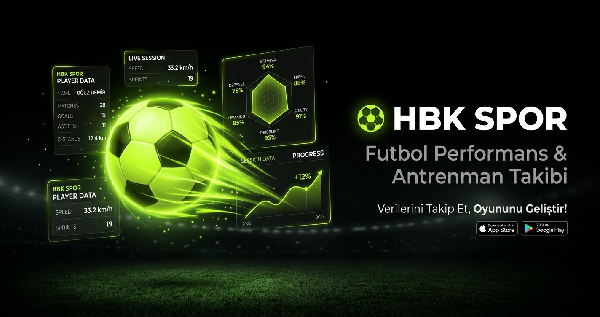

<div align="center">
  
  <h1>HBK SPOR</h1>
  <p><strong>Antrenmanı kafadan değil, kayıttan yönet.</strong><br />Planla. Sahaya çık. Gelişimini gör.</p>
  <p>
    <a href="https://hbkspor.pages.dev/"><strong>⚽ Uygulamayı aç</strong></a>
    ·
    <a href="./HBK_SURUM_NOTLARI.md">Sürüm notları</a>
    ·
    <a href="./hbk-spor-src/README.md">Kaynak ve yayınlama rehberi</a>
  </p>
  <p>
    
    
    
    
  </p>
</div>

---

## Sahadaki emeğin, ekranda da karşılığını bulsun

**HBK Spor**, futbolcuların ve antrenman yapan sporcuların günlük işini tek yerde toplar: antrenmanını planla, yaptığını kaydet, haftalar içindeki yükünü ve gelişimini takip et. Masa başında süslü grafik üretmek için değil; bir sonraki antrenmana daha bilinçli çıkman için.

> **Kısa versiyon:** Planını kur. Gym ve saha çalışmalarını kaydet. Maçlarını ve gelişimini takip et. Verin senin cihazında kalsın.

## Neler var?

| Alan | İçerik |
|---|---|
| **Plan** | Haftalık ve aylık takvim, gün düzenleme, haftalık şablonlar ve hazır antrenman ritimleri |
| **Antrenman ekle** | Gym setleri, saha çalışması, maç, toparlanma, dinlenme ve GPS koşu (Faz 1) kaydı |
| **Saha araçları** | Saha haritası, drill kütüphanesi, alet çantası ve skill testleri |
| **Analiz** | Antrenman yükü, form, maç, gelişim ve tüm kayıtların ayrıntıları |
| **Oyuncu profili** | Oyuncu kartı, kariyer bilgileri, rozetler, çıkartma albümü ve arkadaş kartları |
| **Veri yönetimi** | JSON yedekleme, CSV dışa aktarma, hareket ve şablon yöneticileri |
| **Kas analizi** | Kas grupları, etkin set tahminleri, set ayrıntıları, RPE/dinlenme, dönem özeti ve ilerleme grafiği |

Arayüz telefonda antrenman sırasında kullanılabilecek şekilde tasarlanmıştır; PWA olarak ana ekrana eklenebilir. Uygulama çevrimdışı açılmayı destekler. PWA önbelleği uygulama dosyalarını saklar; kullanıcı verilerinin yedeğini ayrıca almanı öneririz.

## Verin senin. Nokta.

Antrenman kayıtları bu tarayıcıdaki **IndexedDB** ve cihaz içi depolama alanlarında tutulur. Kas analizi modülü mevcut HBK Spor veritabanını bulmadan açmaz; bulduğunda da antrenman kayıtlarını **salt okunur** şekilde kullanır. Var olan veritabanı sürümünü yükseltmez, kayıtlarını değiştirmez veya sıfırlamaz.

Set bazında girilen yeni **RPE** ve **dinlenme** bilgileri ayrı bir yerel anahtarda saklanır. Ana uygulamanın yedeğinden ayrı oldukları için bu ek bilgileri kas analizi penceresindeki **Set yedeğini indir / içe aktar** kontrolleriyle taşı.

> **RPE bir öz bildirimdir.** Kas grubu eşleştirmeleri ve ana/yardımcı kas set katsayıları yaklaşık planlama göstergeleridir; ölçülmüş yorgunluk, sakatlık riski, sağlık değerlendirmesi veya kas gelişimi vaadi değildir.

## Hemen dene

[**HBK Spor'u tarayıcıda aç →**](https://hbkspor.pages.dev/)

Uygulama bir hesap oluşturmadan kullanılabilir. Kendi verinle başlamadan önce mevcut yedeğini sakla; başka cihazda kullanacaksan uygulamanın yedekleme/dışa aktarma araçlarını kullan.

## Kaynak kodu: önemli bir dürüstlük notu

Bu repoda uygulamanın önceki kapsamlı sürümünün **özgün React kaynakları ve source map dosyaları yoktu**. Bu nedenle eski kaynakları geri elde etmiş gibi davranmıyoruz.

- [`hbk-spor-src/`](./hbk-spor-src/) mevcut kapsamlı derlenmiş uygulamayı statik varlık olarak korur ve üzerine düzenlenebilir **kas analizi** kaynağını ekler.
- [`source-rebuild/`](./source-rebuild/) ayrı, çalıştırılabilir bir kaynak yeniden oluşturumudur. Eski uygulamanın birebir kaynak portu değildir ve bütün eski özelliklerin aynısını sunduğu iddia edilmez.
- Depo kökündeki statik dosyalar mevcut dağıtım paketini korur.

Özetle: kapsamlı eski uygulamayı kaybetmeden yeni analizi kaynak koduyla geliştirebiliyoruz; ancak derlenmiş eski modüller hâlâ özgün kaynak değildir.

## Geliştirme

### Kapsamlı uygulama paketi + kas analizi

```bash
cd hbk-spor-src
npm ci
npm run test
npm run dev
```

Üretim derlemesi ve yerel önizleme:

```bash
npm run build
npm run preview
```

`npm run test`, mevcut IndexedDB v2 verisiyle uyumluluğu ve kas/set hesaplamalarının temel kurallarını kontrol eder. Güncel ayrıntılar için [`hbk-spor-src/README.md`](./hbk-spor-src/README.md) dosyasına bak.

### Bağımsız kaynak yeniden oluşturumu

```bash
cd source-rebuild
npm ci
npm run dev
```

Bu ikinci proje de düzenlenebilir bir başlangıç noktasıdır; kapsamı ve depolama yapısı `source-rebuild/README.md` içinde açıklanır.

### Cloudflare Pages

`hbk-spor-src/` projesini Git bağlantısıyla derlemek için:

- **Root directory:** `hbk-spor-src`
- **Build command:** `npm run build`
- **Build output directory:** `dist`
- **Node.js:** 18 veya üzeri

Bu repo kendi başına üretime deploy etmez. Yayına almadan önce build/test sonuçlarını ve mevcut kullanıcı verileriyle davranışı doğrula.

## Depo düzeni

```text
.
├── index.html, assets/, sw.js     # Korunan dağıtım dosyaları
├── hbk-spor-src/                 # Kapsamlı paket + kaynak kodlu kas analizi
│   ├── src/                      # React/TypeScript analizi ve testler
│   └── public/                   # Korunan uygulama paketi ve PWA varlıkları
├── source-rebuild/               # Bağımsız kaynak yeniden oluşturumu
├── HBK_SURUM_NOTLARI.md          # Sürüm kapsamı ve dağıtım notları
└── SURUM.txt                     # Paket kimliği
```

## Katkı

Hata bulduysan veya geliştirme fikrin varsa bir issue aç; değişiklik göndermeden önce ilgili projede test ve üretim derlemesini çalıştır. Gerçek kullanıcı verilerini, yedekleri veya kişisel bilgileri issue ve pull request'lere ekleme.

## Lisans

Bu depoda henüz bir lisans dosyası bulunmuyor. Açık kaynak lisansı eklenene kadar kodun yeniden kullanım ve dağıtım izinlerinin ayrıca netleştirilmesi gerekir.
